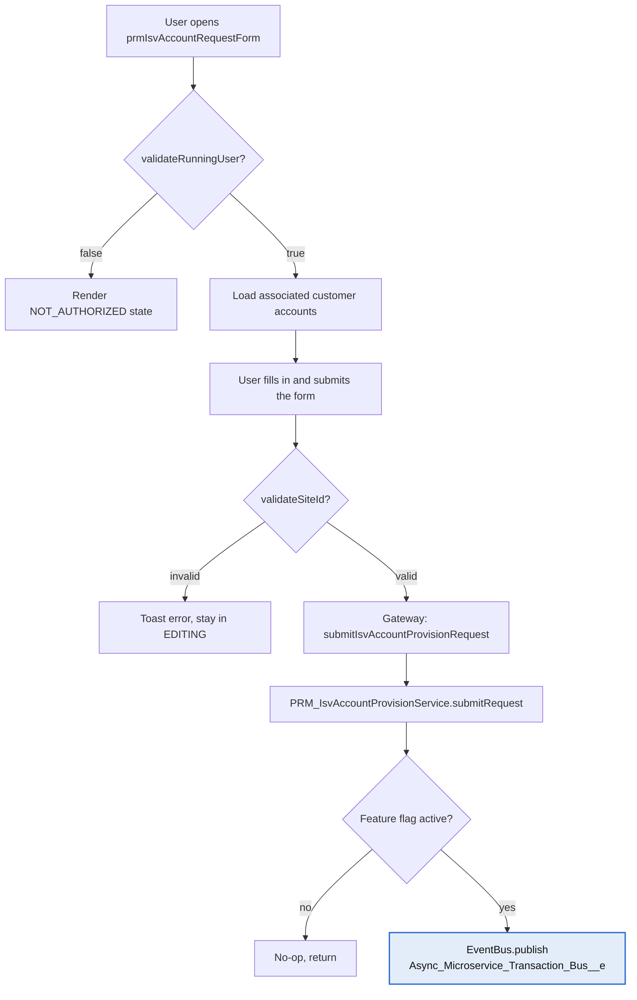
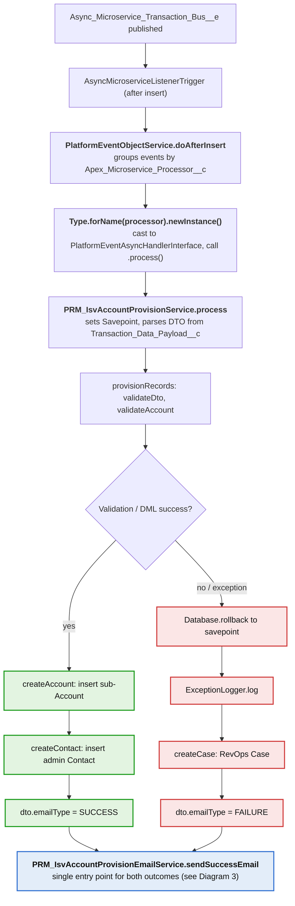
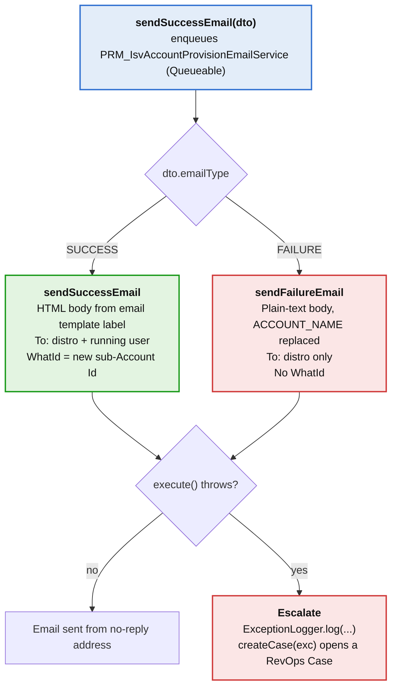

# ISV Sub-Account Provisioning — Process & Notification Flow

Technical documentation of the ISV sub-account provisioning workflow on the Partner Portal, spanning the LWC form, async platform events, Account/Contact creation, and email notifications.

## Contents

- [Overview](#overview)
- [1. LWC Form — `prmIsvAccountRequestForm`](#1-lwc-form--prmisvaccountrequestform)
- [2. Gateway / Service / DTO Architecture](#2-gateway--service--dto-architecture)
- [3. Async Dispatch Chain](#3-async-dispatch-chain)
- [4. Record Creation](#4-record-creation)
- [5. Validation Rules](#5-validation-rules)
- [6. Email Notifications — `PRM_IsvAccountProvisionEmailService`](#6-email-notifications--prm_isvaccountprovisionemailservice)

---

## Overview

This document traces the complete ISV sub-account provisioning flow on the Partner Portal, from form rendering and access control through asynchronous record creation and email notification.

The architecture spans five layers:

- An LWC form (`prmIsvAccountRequestForm`)
- An Aura-enabled Gateway (`PRM_IsvAccountProvisionGateway`)
- A Service layer implementing an async platform-event handler interface (`PRM_IsvAccountProvisionService`)
- A DTO (`PRM_IsvAccountProvisionDTO`)
- A dedicated email notification service (`PRM_IsvAccountProvisionEmailService`)

---

## 1. LWC Form — `prmIsvAccountRequestForm`

The form is exposed to `lightning__AppPage`, `lightning__HomePage`, and `lightningCommunity__Page`, making it available on the Partner Community.

### Access-control gating

On `connectedCallback()`, the component calls `fetchAccount()`, which performs **authorization before rendering any form fields**:

1. Calls `validateRunningUser({ userId })` (via the Gateway). If this returns `false`, the component state is set to `NOT_AUTHORIZED` and the template renders "You do not have access to view this page." instead of the form.
2. If authorized, calls `getAssociatedCustomerAccounts({ userId })` to populate the **Parent Account Site ID** combobox with the user's eligible customer account(s).

### Form fields

| Field | Input type / notes |
| --- | --- |
| Parent Account Site ID | Combobox, populated from associated customer accounts |
| End Customer Company Name | Text |
| End Customer Address | Street, city, state/province, postal code, country |
| DocuSign Admin's First Name / Last Name | Text |
| Email | Email |
| Phone | Phone |
| **Server Location** | Combobox: `AU`, `CA`, `EU1`, `NA1`, `NA2`, `NA3`, `NA4` |
| Notes | Free text, max 1000 chars |

### Submission

On submit, `handleSubmitClick()`:

1. Validates required inputs client-side.
2. Re-validates the Site ID via `validateSiteId({ userId, siteId })` — if invalid, shows a toast and aborts.
3. Calls `submitIsvAccountProvisionRequest({ formData })` with a JSON payload containing `runningUserId`, `accountSiteId`, `companyName`, `firstName`, `lastName`, `email`, `phone`, `server`, `notes`, and `address`.

---

## 2. Gateway / Service / DTO Architecture

### `PRM_IsvAccountProvisionGateway`

Aura-enabled Apex controller, the only Apex surface the LWC talks to directly. Each method delegates to `PRM_ServiceManager.systemMode.isvAccountProvision` and wraps exceptions as `AuraHandledException`:

- `getAssociatedCustomerAccounts(userId)`
- `submitIsvAccountProvisionRequest(formData)`
- `validateRunningUser(userId)`
- `validateSiteId(userId, siteId)`

### `PRM_IsvAccountProvisionService`

Implements `PlatformEventAsyncHandlerInterface`. Holds both the synchronous validation/lookup logic called by the Gateway and the asynchronous provisioning logic triggered by the platform event.

| Method | Purpose |
| --- | --- |
| `submitRequest(formData)` | Gated by `Switches.PRM_PORTAL_ISV_ACCOUNT_REQUEST`; publishes an `Async_Microservice_Transaction_Bus__e` event |
| `getAssociatedCustomerAccounts(userId)` | Resolves the user's parent Account, then the related Customer account(s) |
| `validateRunningUser(userId)` | Authorization check used to gate form rendering |
| `validateSiteId(userId, siteId)` | Confirms a submitted Site ID belongs to the user |
| `process(lstEvents)` | Async handler entry point invoked by dynamic dispatch (see Section 3) |
| `provisionRecords()` | Orchestrates DTO/account validation and record creation |

### `PRM_IsvAccountProvisionDTO`

Data wrapper shuttled as serialized JSON through the platform event payload.

| Field | Purpose |
| --- | --- |
| `accountSiteId` | Parent account lookup key |
| `subAccountId` | Populated after sub-Account creation (for email `WhatId`) |
| `companyName` | New sub-Account name |
| `server` | Server Location selection from the form |
| `notes` | Free-text notes |
| `address` (nested `Address`) | street, city, province, state, country, postalCode |
| `firstName`, `lastName`, `phone`, `email` | DocuSign Admin contact fields |
| `emailType` | `SUCCESS` or `FAILURE` enum, set by the Service before invoking the email service |
| `runningUserId`, `runningUserEmail` | Submitting user context |

`validate()` requires `runningUserId`, `accountSiteId`, `companyName`, `email`, `firstName`, `lastName`, `phone`, and a valid `Address` (street, city, postalCode, country, and either province or state).

---

## 3. Async Dispatch Chain

Form submission does not create records synchronously. It publishes a platform event, which is routed to the Service through a generic dynamic-dispatch mechanism shared by many PRM/CRM async handlers in the org.

1. **`PRM_IsvAccountProvisionService.submitRequest`** — builds an `Async_Microservice_Transaction_Bus__e` record:
    - `Transaction_Data_Payload__c` = JSON-serialized form data
    - `Apex_Microservice_Processor__c` = `'PRM_IsvAccountProvisionService'`
    - Publishes via `EventBus.publish`.
2. **`AsyncMicroserviceListenerTrigger`** (after insert trigger on `Async_Microservice_Transaction_Bus__e`) — calls `PlatformEventObjectService.doAfterInsert(Trigger.new)`.
3. **`PlatformEventObjectService.doAfterInsert`** — groups incoming events by `Apex_Microservice_Processor__c`, then for each processor key dynamically resolves the class via `Type.forName(processor).newInstance()`, casts it to `PlatformEventAsyncHandlerInterface`, and calls `.process(events)`.
4. **`PRM_IsvAccountProvisionService.process(lstEvents)`** — the resolved handler:
    - Sets a `Database.Savepoint`.
    - Parses the DTO from `Transaction_Data_Payload__c`.
    - Calls `provisionRecords()` to create the sub-Account and Contact.
    - On success: sets `dto.subAccountId`, `dto.emailType = SUCCESS`, calls `PRM_ServiceManager.email.isvAccountProvision.sendSuccessEmail(dto)`.
    - On exception: rolls back to the savepoint, logs via `ExceptionLogger`, creates a RevOps Case, sets `dto.emailType = FAILURE`, and still calls `sendSuccessEmail(dto)` (the single entry point that branches internally by `emailType`).

### End-to-end flow

The flow is split into three diagrams so each stays readable: the synchronous form path, the async provisioning path, and the email service.

#### Diagram 1 — Form access and submission

Three gates stand before any record work: the user check, the Site ID check, and the `PRM_PORTAL_ISV_ACCOUNT_REQUEST` feature flag.

#### Diagram 2 — Async dispatch and record provisioning

Both branches converge on `sendSuccessEmail(dto)`; only `dto.emailType` tells the email service which message to send.

#### Diagram 3 — Email service branching and escalation

The running user only hears back on success; on failure they get no email, and RevOps is alerted through the distro and a Case.

---

## 4. Record Creation

`provisionRecords()` sequence (all within the Service's `process()` savepoint):

1. `validateDto()` — re-validates the parsed DTO.
2. `getParentAccountBySiteId(dto.accountSiteId)` — resolves the parent Account.
3. `validateAccount(parentAccount)` — see Section 5.
4. `getAccountConfigId(parentAccount.DocuSignEnvironmentAccountSuffix__c)` — resolves `DOSS_AccountConfiguration__c` by suffix.
5. `getNamedAccount(parentAccount.Named_Account__c)` — normalizes Parent/Child naming.
6. `createAccount(...)` — inserts the sub-Account.
7. `createContact(accountId)` — inserts the admin Contact, if the Account insert succeeded.

### Sub-Account field mapping (`createAccount`)

| Field | Source |
| --- | --- |
| `Name` | `dto.companyName` |
| `ParentId`, `Subscription_Owner__c` | `parentAccount.Id` |
| `DocuSignEnvironment__c` | resolved `accountConfigId` |
| `BillingStreet/City/State/PostalCode/Country` | `dto.address.*` |
| `Phone`, `Billing_Phone__c`, `Fax`, `OwnerId`, `SAM_Tier__c`, `TCSM__c`, `TCSM_Program__c`, `Industry`, `Industry_Override__c`, `Client_Services_Executive__c`, `Website`, `EBR__c`, `ESR__c`, `Account_Score__c` | copied from `parentAccount` |
| `Type` | `TYPE_CUSTOMER_SUB` |
| `DUNS_Number__c` | `DUNS_CUST_SUB` |
| `DocuSign_Enrollment_Stage__c` | `ENROLLMENT_STAGE_PENDING` |
| `Named_Account__c` | computed `namedAccount` |
| `Territory_Type__c` | `parentAccount.Territory_Type__c` |
| `DocuSign_Account_Type__c` | `DS_TYPE_CUSTOMER_MANAGED_PARTNER` |
| `Partner_Referring_Account2__c` | `parentAccount.Partner_Referring_Account2__c` |
| `Sales_Channel__c` | `SALES_CHANNEL_ISV_EMBED` |
| `Sales_Channel_Sub_Category__c` | `SALES_CHANNEL_SUB_ISV_LICENSE_CUSTOMER` |
| `RecordTypeId` | `customerManagedByPartnerRecordTypeId` (RecordType `DS_TYPE_CUSTOMER_MANAGED_PARTNER_API`) |
| `Provisioned_By__c` | `PROVISIONED_BY_ISV_FORM` |

Inserted with `Database.DMLOptions.DuplicateRuleHeader.AllowSave = true`.

> **Note:** `dto.server` (Server Location) is **not mapped to any field** on this record.

### Admin Contact field mapping (`createContact`)

| Field | Source |
| --- | --- |
| `FirstName`, `LastName`, `Phone`, `Email` | `dto.firstName/lastName/phone/email` |
| `AccountId` | newly created sub-Account Id |
| `DS_Admin__c` | `true` |
| `Origin_Source__c` | `TYPE_CUSTOMER_SUB` |
| `MailingStreet/City/State/PostalCode/Country` | `dto.address.*` |

Also inserted with `DuplicateRuleHeader.AllowSave = true`.

---

## 5. Validation Rules

### `validateAccount(acct)` — throws `DataException` if:

- Account is null ("missing account" message)
- `DS_Status__c` = Closed ("record closed" message)
- `Type` ≠ `Customer` ("not a customer" message)
- `DocuSignEnvironmentAccountSuffix__c` is blank ("missing env suffix" message)
- `Billing_Subscriptions__r` is null or empty ("missing billing sub" message)

### `isValidIsvCustomer(acct)` — filters accounts returned to the client:

- `Type` equals `Customer` (case-insensitive)
- `Sales_Channel__c` equals `ISV Embed`
- `Sales_Channel_Sub_Category__c` equals `ISV License`
- `Site_Id__c` is not blank
- `Partner_Referring_Account2__c` is not null

### `validateRunningUser(userId)` — gate for form access:

- Resolved parent account is not null
- `Account_Status_Detail__c` equals `Active`
- `Sales_Channel__c` equals `ISV Embed`
- `Sales_Channel_Sub_Category__c` equals `ISV License`

### `validateSiteId(userId, siteId)`:

- The Account matching the submitted Site ID must equal one of the user's associated customer accounts, OR match the user's parent Partner account directly.

---

## 6. Email Notifications — `PRM_IsvAccountProvisionEmailService`

Implements `Queueable`. Invoked via `sendSuccessEmail(dto)`, which enqueues the job; `execute()` branches internally on `dto.emailType` to send either the success or failure email.

### Summary

| | Success Email | Failure Email |
| --- | --- | --- |
| **Trigger condition** | `dto.emailType == EMAIL_TYPE.SUCCESS` (provisioning succeeded) | `dto.emailType == EMAIL_TYPE.FAILURE` (exception in `process()` or missing DTO) |
| **Subject** | `'ISV Embed Sub Account Provisioning Request Confirmation – {firstName} {lastName}'` | `'ISV Sub-Account Provision Error'` |
| **Recipients** | `System.Label.PRM_IsvAccountProvisionEmailUserId` (fixed distro) **+** running user's email (via `Selectors.user.selectByIdForContext(dto.runningUserId)`) | `System.Label.PRM_IsvAccountProvisionEmailUserId` only — running user is **not** included |
| **Body source** | `System.Label.PRM_IsvAccountProvisionEmailTemplate`, merge-formatted | `System.Label.PRM_IsvAccountProvisionFailureEmailTemplate`, with `{{ACCOUNT_NAME}}` token replaced |
| **Format** | HTML (`setHtmlBody`) | Plain text (`setPlainTextBody`) |
| **WhatId** | New sub-Account Id (`dto.subAccountId`) | Not set |
| **From** | No-reply Org-Wide Email Address (`PRM_ServiceManager.messaging.getNoReplyOrgWideEmailAddressId()`) | Same no-reply Org-Wide Email Address |

### Success email body construction

`generateSuccessBodyTemplate()` merge-formats the label template with, in order:

1. `dto.companyName`
2. Concatenated address (`street, city, state/province, postalCode, country`)
3. `dto.firstName`
4. `dto.lastName`
5. `dto.email`
6. `dto.notes` (or `'No additional notes'` if blank)
7. `dto.accountSiteId`
8. `dto.server` (Server Location)

An image is appended (`System.Label.PRM_IsvAccountProvisionEmailTemplateImageURL`), and a `SupportTextAnnotation` placeholder in the merged message is replaced with `System.Label.SupportTextProvisioningEmail`.

> **Confirmed gap:** the **Server Location** value entered on the form (`dto.server`) is used **only** here — in the success email body. It is read into the DTO and passed through the entire pipeline, but is never written to any field on the sub-Account or Contact record. There is no persisted record of which server location was selected.

### Failure email body construction

`generateFailureBodyTemplate()` takes the failure label template and replaces the `{{ACCOUNT_NAME}}` token with `dto.companyName` (or `'[NO ACCOUNT NAME PROVIDED]'` if unavailable).

### Escalation on email failure

If `execute()` itself throws (e.g., missing `subAccountId`, missing running user record, or any other exception while sending), the Email Service:

1. Logs via `ExceptionLogger.log(...)`.
2. Calls `createCase(exc)` → `PRM_Utilities.cases.createRevopsCase(...)` to open a RevOps Case describing the failure and serialized DTO.

This mirrors the fallback in the Service's `process()` method: any exception during record provisioning also creates a RevOps Case (via the same utility) in addition to triggering the failure email path — giving two independent escalation points (provisioning failure and email-send failure).
